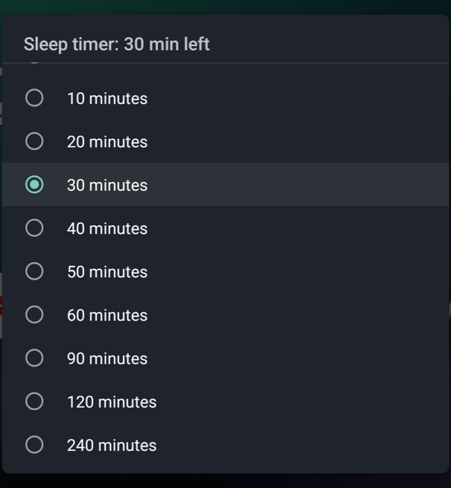

# TCL TV Sleep Timer

A one-tile sleep timer for TCL Google TVs. Open it with the remote, pick **Off** or **10 to 240 minutes**,
and the TV turns itself off with TCL's own countdown and warning, the same as the sleep timer in TCL's
quick settings bar. While a timer is running, the title shows how long is left.



It was made for [TV Detox](https://github.com/Ansub/tv-detox) home screens, where it fits in as a normal
app tile, but it works from any launcher.

**Tested on** a TCL 50Q651G (Google TV, Android 12). Other TCL Google TVs on Android 12 or 13 probably
work the same way, but haven't been tried. Use it at your own risk.

## How it works

TCL's settings app sets the sleep timer by writing one system setting, `tcl_app_power_off_time_delay`,
in milliseconds (`-1` is off). TCL's `PowerOffAlarmManager` in System UI watches that setting, runs the
countdown and shows the "turning off" warning. This app writes the same setting, with the same choices
TCL offers, and reads `tcl_app_power_off_time_expire` to show the time left.

You can try it without the app:

```sh
adb shell settings put system tcl_app_power_off_time_delay 600000   # 10 minutes
adb shell settings put system tcl_app_power_off_time_delay -1       # off
```

## Why it targets Android 5.1

Since Android 6, ordinary apps may only write Android's public settings, not a vendor setting like this
one. Apps that target Android 5.1 (API 22) or older are still allowed to, so this app targets API 22 on
purpose. Android 12 installs it and shows a one-time "built for an older version of Android" notice;
dismiss it once. **Android 14 refuses to install apps this old**, so this won't install on TCL TVs that
run Android 14.

## Build and install

You need Java 17 and the Android SDK (platform 34, build-tools 34). On a Mac:

```sh
brew install openjdk@17 && brew install --cask android-commandlinetools
sdkmanager "platforms;android-34" "build-tools;34.0.0"
sh build.sh                                    # makes out/sleep.apk
adb -s <TV_IP>:5555 install out/sleep.apk      # Developer options > USB debugging must be on
```

`build.sh` makes a signing key (`key.jks`) on the first build. Keep it: updates must be signed with the
same key. Then add **Sleep** to your home screen like any other app. To remove it:
`adb -s <TV_IP>:5555 uninstall local.tvsleep`.

## License

MIT. The moon icon is the Material Icons "bedtime" path (Apache 2.0).
